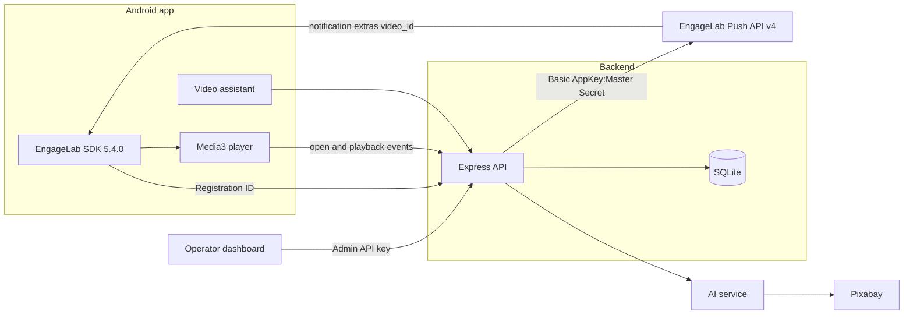

# EngageVideo

EngageVideo is an Android short-video product with a signed-in recommendation feed, a Pixabay-backed assistant, and EngageLab AppPush for targeted notifications. An operator dashboard composes campaigns and A/B experiments against the devices this backend has stored.

The phone obtains its Registration ID from the EngageLab SDK. The backend stores that ID and is the only component that calls the EngageLab REST API. The Master Secret never leaves the server. A provider `msg_id` means EngageLab accepted the request. It does not mean the phone displayed the notification.



## What the product does

- Email one-time sign-in, optional password, onboarding, and saved video interests. Gender is not used for ranking.
- A home feed of playable Pixabay videos. Signed-in viewers see interest sections such as “Because You Like …”. Guests see a non-personalized popular feed.
- Search with All, Short, and Long filters based on the video’s duration.
- A video assistant that searches Pixabay and returns playable cards. It declines image requests and does not invent videos.
- Targeted push by one Registration ID, a stored list, saved interests, an EngageLab tag, or a confirmed broadcast. An empty audience is rejected. It is not widened to every user.
- A/B experiments that assign each real device to one variant. Fewer than two stored devices cannot start. A labelled simulation uses synthetic users and is excluded from real sample size, delivery, and click-through. One device can receive a separate single-variant test. Statistical significance is reported only at 30 real devices per variant.
- Notification matching that can consider several saved interests, opt-out, quiet hours, frequency caps, duplicates, and missing devices. Automatic digest release stays off unless both scheduler flags are set.

The video-library screen is hidden in the dashboard. Opening `/library` returns to Overview. The library API remains in the backend for tests and is not offered as an operator workflow in this version.

## Stack

| Part | Implementation |
| --- | --- |
| Android | Kotlin, Jetpack Compose, Material 3, Navigation, Media3 ExoPlayer 1.5.1, OkHttp, EngageLab `com.engagelab:engagelab:5.4.0` |
| Backend | Node.js 22, TypeScript, Express, Zod, SQLite (`node:sqlite`), Pino |
| AI service | Python, FastAPI, a bounded recommendation pipeline, Pixabay search |
| Dashboard | React, TypeScript, Vite |

Application id: `com.example.engagevideopush`. The EngageLab data center used by this project is Singapore (`https://pushapi-sgp.engagelab.com`, site name `Singapore`, timezone `Asia/Singapore`).

## Repository

```
EngageVideoPush/
├── android/       Android app: sign-in, feed, player, assistant, device registration
├── backend/       API, SQLite, EngageLab client, personalization, tests, openapi.yaml
├── ai-service/    Recommendation service and skill instructions
├── dashboard/     Operator UI for devices, campaigns, and experiments
├── docs/          Setup, API, architecture, testing, and operator notes
├── scripts/       Android build helper
├── docker-compose.yml
└── package.json
```

| Path | Role |
| --- | --- |
| `android/app/src/main/java/com/example/engagevideopush/` | App UI, session, backend client, and EngageLab registration |
| `backend/src/app.ts` | HTTP routes and service wiring |
| `backend/src/services/` | Audience resolution, campaigns, experiments, auth, and personalization |
| `backend/src/integrations/engagelabClient.ts` | EngageLab REST v4 client. The Master Secret stays here |
| `backend/src/integrations/pixabay.ts` | Pixabay catalogue. Playback files remain on Pixabay |
| `ai-service/app/pipeline.py` | Intent handling, at most three Pixabay searches, and the reply text |
| `ai-service/skills/` | Instructions used by the recommendation pipeline |
| `dashboard/src/pages/` | Overview, videos, devices, composer, experiments, history, and AI analytics |
| `docs/ARCHITECTURE.md` | Request path, EngageLab calls, and stored data |
| `docs/API_REFERENCE.md` | HTTP contracts |
| `docs/ENGAGELAB_SETUP.md` | Console, data center, and credential placement |
| `docs/ANDROID_SETUP.md` | SDK, Gradle, and install |
| `docs/PERSONALIZATION.md` | Onboarding, recommendations, and notification matching |
| `docs/ADMIN_QA.md` | Experiment, dry-run, and one-device test procedure |
| `docs/TESTING.md` | Automated and manual checks |
| `docs/TROUBLESHOOTING.md` | Registration, data-center, and playback failures |
| `docs/PHASE2_4.md` | Assistant and account data added after the first push demo |
| `docs/DEMO_SCRIPT.md` | Short live demonstration order |
| `docs/INTERVIEW_GUIDE.md` | How registration, push, and attribution work |
| `docs/IMPLEMENTATION_AUDIT.md` | Historical audit from 2026-11-02. It is not the current specification |

## Configure

1. Start from `backend/.env.example`. The real `backend/.env` is gitignored. Do not commit it.
2. Set `ENGAGELAB_APPKEY`, `ENGAGELAB_MASTER_SECRET`, and `ENGAGELAB_BASE_URL` together. Leave all three empty for labelled demo mode. A partial set stops startup.
3. Set `ENGAGELAB_SITE_TIMEZONE` to the data center’s main-site zone.
4. Copy `android/engagelab.properties.example` to `android/engagelab.properties`. Set the same AppKey and the SDK site name. Do not put the Master Secret in that file.
5. Set `ADMIN_API_KEY` to a long random string. The dashboard sends it as `Authorization: Bearer <key>`.
6. Email codes use SMTP settings in `backend/.env`. `AUTH_EMAIL_MODE=test` accepts codes without sending mail. Automated tests use that mode.
7. `AI_SERVICE_URL` defaults to `http://127.0.0.1:8000`. Model and Pixabay keys stay in `backend/.env`.

Choose the EngageLab host from the console Service Endpoint. The host and the Android site name must name the same data center. Details are in [docs/ENGAGELAB_SETUP.md](docs/ENGAGELAB_SETUP.md).

## Run

From `EngageVideoPush` in PowerShell, with Node on `PATH`:

```powershell
npm run install:all
npm run start:backend
npm run start:dashboard
```

From `ai-service`:

```powershell
py -3 -m uvicorn app.main:app --host 127.0.0.1 --port 8000
```

- API: http://localhost:3000/api/health
- OpenAPI: http://localhost:3000/api/openapi.yaml
- Dashboard: http://localhost:5173

Startup does not send a push. The notification scheduler starts only when `SCHEDULER_ENABLED=true`, and it releases queued digests only when `SCHEDULER_CONFIRM=true` as well. Both stay unset in the example environment.

Android, from `android`, after the SDK is installed:

```powershell
.\gradlew.bat assembleDebug
```

Install `app/build/outputs/apk/debug/app-debug.apk`. A debug build points an emulator at `http://10.0.2.2:<PORT>` and a phone at the computer’s LAN address captured at build time. `BACKEND_PORT` in `android/engagelab.properties` must match the backend `PORT`. Release builds do not allow cleartext HTTP.

## Dashboard

Sign in with `ADMIN_API_KEY`. The banner says **Live EngageLab mode** or **Demo mode**.

- **Compose** targets one Registration ID, every stored device, saved interests, an EngageLab tag, or a confirmed broadcast. Interest targeting uses the categories a signed-in account saved, then that account’s stored Registration IDs. Tag targeting still uses the device tags `tech`, `funny`, and `lifestyle`.
- **A/B tests** always show a result for Start: a validation message, a progress label, or the backend success or error. Preview does not send. Simulation is labelled and is not a real audience. A single-device send is separate from the experiment sample.
- **History** separates provider message and schedule IDs from opens and plays reported by the app.

Demo mode records `simulated` and does not call EngageLab. Live mode can call EngageLab when an operator confirms a send. This repository does not treat that acceptance as device delivery.

## Push example

```http
POST /api/devices/register
Content-Type: application/json

{
  "registrationId": "the-id-from-the-sdk",
  "platform": "android",
  "categories": ["tech"]
}
```

```http
POST /api/campaigns
Authorization: Bearer <ADMIN_API_KEY>
Content-Type: application/json

{
  "name": "Interest pick",
  "videoId": "pixabay-video-id",
  "title": "A short video for you",
  "message": "Tap to watch.",
  "targeting": { "mode": "registration_id", "registrationId": "the-id-from-the-sdk" },
  "delivery": "immediate"
}
```

`accepted_by_provider` means EngageLab returned `msg_id`. `simulated` means the provider was not called.

## Tests

```powershell
npm test
npm run typecheck
npm run build:dashboard
```

From `ai-service`:

```powershell
py -3 -m pytest -q
```

From `android`, after the SDK is installed:

```powershell
.\gradlew.bat test
```

Backend tests use an in-memory database and mock EngageLab, Pixabay, and the model. They do not send a live push and do not require a live model key.

## Limits

- One registered device cannot fill both A/B variants or support a significance claim.
- Synthetic experiment users are not recipients, deliveries, or click-through.
- Topic labels for notification matching come from the video category and keywords, not from a second model call.
- The EngageLab core SDK is integrated. FCM and vendor-channel SDKs are not.
- SQLite and one Node process are sufficient for this project. They are not a multi-server deployment.
