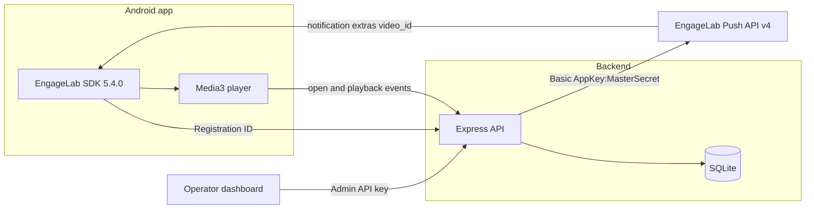

# EngageVideoPush

EngageVideoPush is a short-video recommendation demo for the EngageLab AppPush workflow. An Android app obtains a real Registration ID, a Node.js API stores the device and sends pushes through the EngageLab REST API v4, and an operator dashboard composes campaigns, schedules, category targets, and A/B experiments.

The Master Secret stays on the backend. The Android app and the dashboard never receive it.



## Stack

- Android: Kotlin, Jetpack Compose, Material 3, Navigation, Media3 ExoPlayer, OkHttp, EngageLab `com.engagelab:engagelab:5.4.0`
- Backend: Node.js 22, TypeScript, Express, Zod, SQLite (`node:sqlite`), Pino
- Dashboard: React, TypeScript, Vite

Application id: `com.example.engagevideopush`

## Prerequisites

- Node.js 22.13 or newer
- Android Studio with SDK platform 35, build-tools, and JDK 17 to compile the app
- An EngageLab AppPush application whose package name is `com.example.engagevideopush`
- The console Service Endpoint, so the REST base URL and the Android site name refer to the same data center
- A device or emulator, plus internet access for the sample videos

Docker is optional and is not required.

## Layout

```
EngageVideoPush/
├── android/          Kotlin app and EngageLab SDK integration
├── backend/          API, SQLite, EngageLab client, tests, openapi.yaml
├── dashboard/        Operator UI
├── docs/             Setup, API, testing, demo, and interview notes
├── scripts/          Android build helper
├── docker-compose.yml
└── package.json
```

## Configure

1. `backend/.env.example` shows every variable. The local `backend/.env` is gitignored.
2. Set `ENGAGELAB_APPKEY`, `ENGAGELAB_MASTER_SECRET`, and `ENGAGELAB_BASE_URL` together. Leave all three empty for labeled demo mode. A partial set stops startup.
3. Set `ENGAGELAB_SITE_TIMEZONE` to the main-site IANA zone for that data center. Singapore uses `Asia/Singapore`.
4. Copy `android/engagelab.properties.example` to `android/engagelab.properties`. Set the same AppKey and the SDK site name (`Singapore`, `USA_Virginia`, `DEU_Frankfurt`, or `HongKong`). Do not put the Master Secret in that file.
5. Set `ADMIN_API_KEY` to a long random string. The dashboard sends it as `Authorization: Bearer <key>`.

Official base URLs are listed in [docs/ENGAGELAB_SETUP.md](docs/ENGAGELAB_SETUP.md). Choose the host from the console Service Endpoint, not from the machine's location.

## Run

From `EngageVideoPush` in PowerShell, with Node on `PATH`:

```powershell
npm run install:all
npm run start:backend
npm run start:dashboard
```

- API: http://localhost:3000/api/health
- Dashboard: http://localhost:5173
- OpenAPI: http://localhost:3000/api/openapi.yaml

The process does not send a push when it starts.

Android, from `android` after the SDK is installed:

```powershell
.\gradlew.bat assembleDebug
```

Install `app/build/outputs/apk/debug/app-debug.apk`. A debug build points an emulator at `http://10.0.2.2:<PORT>` and a phone or tablet at this computer's LAN address captured when the app is built. `BACKEND_PORT` in `android/engagelab.properties` must match the backend `PORT`. The Device screen can replace the LAN address without rebuilding. Release builds do not allow cleartext HTTP.

The app asks for an email one-time code before the feed. SMTP settings stay in `backend/.env` (`SMTP_SERVER`, `SMTP_PORT=587`, `SMTP_USERNAME`, `SMTP_PASSWORD`, `SENDER_EMAIL`, `SESSION_PEPPER`). `AUTH_EMAIL_MODE=test` accepts codes without sending mail. Automated tests use that mode and do not send email or live pushes.

## Dashboard

Sign in with `ADMIN_API_KEY`. The banner says **Live EngageLab mode** or **Demo mode**. Demo results are labeled simulated and are not deliveries. Provider delivery counts stay unavailable unless EngageLab returns them; this project does not invent a click-through rate.

Use Compose to target one Registration ID, a category, an EngageLab tag, or a confirmed broadcast. History shows provider message or schedule IDs separately from device-reported opens and plays.

## Example

```http
POST /api/devices/register
Content-Type: application/json

{
  "registrationId": "the-id-from-the-sdk",
  "platform": "android",
  "categories": ["tech"]
}
```

```http
POST /api/campaigns
Authorization: Bearer <ADMIN_API_KEY>
Content-Type: application/json

{
  "name": "Tech pick",
  "videoId": "1001",
  "title": "A short video for you",
  "message": "Tap to watch.",
  "targeting": { "mode": "registration_id", "registrationId": "the-id-from-the-sdk" },
  "delivery": "immediate"
}
```

`accepted_by_provider` means EngageLab returned `msg_id`. It does not mean the phone displayed the notification. `simulated` means the provider was not called.

## Tests

```powershell
npm test
npm run typecheck
npm run build:dashboard
```

Android unit tests, once the SDK is installed:

```powershell
cd android
.\gradlew.bat test
```

## Screenshots

Screenshots were not captured in this environment because no emulator was attached.

| Surface | What you should see |
| --- | --- |
| Android feed | Three sample videos with category, description, and Play |
| Android device | SDK status and the real Registration ID after connect |
| Dashboard overview | Device, campaign, and event counts with source labels |
| Composer result | Provider `msg_id` or a simulated banner |

## More documentation

- [Architecture](docs/ARCHITECTURE.md)
- [API reference](docs/API_REFERENCE.md)
- [EngageLab setup](docs/ENGAGELAB_SETUP.md)
- [Android setup](docs/ANDROID_SETUP.md)
- [Testing](docs/TESTING.md)
- [Troubleshooting](docs/TROUBLESHOOTING.md)
- [AI pipeline and phases 2–4](docs/PHASE2_4.md)
- [Demo script](docs/DEMO_SCRIPT.md)
- [Interview guide](docs/INTERVIEW_GUIDE.md)
