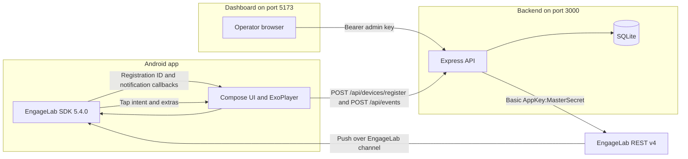

# EngageVideoPush implementation audit

Audit date: 2026-11-02. Scope is the tree at `EngageVideoPush/` as it existed during this inspection. No application code was changed for this audit.

The uploaded file `engage lab.docx` is not in the workspace and was not inspected. API and SDK comparisons below use cached copies of the current EngageLab documentation pages that were fetched earlier and re-read for this audit:

- Create Push API (`POST /v4/push`)
- Tag Alias API (`/v4/devices`, `/v4/tags`)
- Scheduled Tasks API (`POST /v4/schedules`)
- Android SDK integration guide (`MTPushPrivatesApi.init`, `MTCommonService`, `MTCommonReceiver`, manifest placeholders, `message_json`)
- `MTCorePrivatesApi` reference (`configAppKey`, `configAppSiteName`, `configDebugMode`, `getRegistrationId`)

Those caches are not project source. A live device, an emulator, and the EngageLab console UI were not available.

## Remediation after this audit

The following code changes were made after the findings below. The historical findings remain in this document. Later sections that still say `custom_args` is a string, or that Android events cannot be attributed, describe the tree before this remediation.

- `custom_args` on a standard notification is now a JSON object `{ campaign_id }`, matching the Create Push API field table (JSON object, at most 128 serialized characters). It is omitted when that limit would be exceeded. This was not submitted to the live API.
- Device open and playback events take experiment id and variant from the campaign row plus `experiment_assignments`. Client-supplied experiment fields are ignored. A video mismatch or an assignment that does not match the campaign variant is stored without experiment attribution.
- Notification navigation happens only in `MainActivity`, through `PushPayloadParser.fromIntentFields`. The receiver still starts that activity. The dedupe key is video id plus campaign id, so an SDK `message_json` intent and an extras-only intent for the same video collapse inside five seconds.
- Setup docs now state that `com.engagelab:engagelab:5.4.0` is the core channel only. FCM and vendor SDKs were not added.

Still unverified on a device or against a live push: Registration ID, tag writes, `POST /v4/push`, `POST /v4/schedules`, notification display, and notification clicks. `GET /v4/tags/` was the only live provider call, and it was made before this remediation.

## 1. Executive summary

EngageVideoPush is a local demonstration of an Android short-video app, an operator dashboard, and a Node.js API that can submit EngageLab AppPush REST v4 requests. The backend, dashboard, and Android debug unit tests compile and pass. A non-sending credential probe, `GET /v4/tags/` against `https://pushapi-sgp.engagelab.com`, succeeded during this audit.

Nothing in this audit installed the app, obtained a Registration ID, submitted `POST /v4/push` or `POST /v4/schedules`, wrote a device tag, displayed a notification, or played a video. The first unverified step of the end-to-end workflow is launching the Android app on a device or emulator.

The highest-risk gaps for a real notification are:

1. No device has been registered, so a live push cannot be targeted yet.
2. Killed-app delivery is not backed by an FCM or vendor-channel SDK. Only the EngageLab core SDK is integrated.
3. `custom_args` is now a JSON object in code. The live Create Push API has still not accepted or rejected that body.
4. Notification click handling now parses in one place (`MainActivity` / `PushPayloadParser`). The receiver still starts that activity. Neither path has been exercised on a device.
5. A/B success counts are now filled from the stored campaign and assignment. That path is covered by backend tests. It has not been confirmed with a real notification open.

## 2. What the project does

An Android client shows a catalogue of three short videos (Technology, Funny, Lifestyle), plays them with Media3 ExoPlayer, stores category preferences, initializes the EngageLab Android SDK, and posts the SDK Registration ID to the backend. An operator signs into a React dashboard and creates a campaign. The backend builds a v4 push or schedule and, when credentials exist, sends it to EngageLab. The notification extras carry `video_id`, `campaign_id`, and `category`. Tapping the notification is intended to open that video and post playback events. The dashboard reads those SQLite events. It does not invent EngageLab delivery or click-through rates.

### Technologies

| Layer | Stack actually declared |
|---|---|
| Android | Kotlin 2.0.21, Android Gradle Plugin 8.7.3, Gradle 8.11.1, compileSdk/targetSdk 35, minSdk 24, Jetpack Compose BOM 2024.12.01, Navigation 2.8.5, Media3 1.5.1, OkHttp 4.12.0, DataStore 1.1.1, EngageLab `com.engagelab:engagelab:5.4.0` |
| Backend | Node.js 22.23.4 (executed), Express 4.21, TypeScript 5.8, Zod 3.24, Pino 9, `node:sqlite` `DatabaseSync`, Vitest 3, Supertest 7. No separate HTTP client library; the global `fetch` is used. |
| Dashboard | React 19, React Router 7, Vite 6, Vitest 3. No component library and no chart library. CSS is custom. |
| Data | SQLite file `backend/data/engage.sqlite` when the server runs. Tests use `:memory:`. |
| Optional | `docker-compose.yml` runs only the backend image `node:22-bookworm`. Docker is not required. |

### Architecture



### Workflow the code implements

1. `EngageApplication.onCreate` creates the notification channel `engage_video_push`, then calls `configDebugMode`, `configAppKey`, `configAppSiteName`, and `MTPushPrivatesApi.init` when the AppKey length is 24.
2. `UserReceiver.onConnectStatus(true)` calls `MTCorePrivatesApi.getRegistrationId`.
3. The app `POST`s that id, platform `android`, and categories to `/api/devices/register`.
4. The backend stores the device and, in live mode, tries `POST /v4/devices/{registration_id}` with `tags.add` / `tags.remove`, then `GET /v4/devices/{registration_id}`. `tagSyncStatus` is `synced` only when the GET contains the expected tags.
5. The operator creates a campaign. Immediate sends call `POST /v4/push`. Scheduled sends call `POST /v4/schedules`. Demo mode stores status `simulated` and does not call EngageLab.
6. The push `extras` are `video_id`, `campaign_id`, and `category`. The Android `intent.url` targets `com.example.engagevideopush.MainActivity` with action `com.example.engagevideopush.ACTION_OPEN`.
7. `MainActivity` reads `message_json`, `MTMessageExtra`, `JMessageExtra`, and direct string extras. `UserReceiver.onNotificationClicked` also starts `MainActivity` from `NotificationMessage.extras`.
8. `PushNavigator` drops a repeated dedupe key inside 5 seconds and navigates to `player/{videoId}`.
9. The player resolves the id from the API, then the local catalogue. It plays `asset:///videos/<file>` if that asset exists, otherwise an `https://` URL.
10. The app posts `notification_opened`, `video_opened`, `video_play_started`, and `video_play_completed` when it has a device token and a Registration ID.
11. Overview and history count those rows. `deliveryMetricsAvailable` is hard-coded `false`.

## 3. Actual project structure

Generated output (`node_modules`, `dist`, `android/.gradle`, `android/**/build`) is omitted.

```
EngageVideoPush/
├── package.json
├── docker-compose.yml
├── README.md
├── .gitignore
├── android/
│   ├── build.gradle.kts
│   ├── settings.gradle.kts
│   ├── gradle.properties
│   ├── gradlew.bat
│   ├── gradle/wrapper/gradle-wrapper.properties
│   ├── gradle/wrapper/gradle-wrapper.jar
│   ├── engagelab.properties            gitignored, present, AppKey set
│   ├── engagelab.properties.example
│   ├── local.properties                gitignored, sdk.dir set
│   └── app/
│       ├── build.gradle.kts
│       ├── proguard-rules.pro
│       └── src/main/AndroidManifest.xml
│       └── src/main/assets/videos/README.txt
│       └── src/main/java/com/example/engagevideopush/
│           EngageApplication.kt, MainActivity.kt
│           data/ BackendApi.kt Models.kt UserPreferences.kt VideoRepository.kt
│           push/ UserService.kt UserReceiver.kt PushNavigator.kt
│                PushPayloadParser.kt NotificationOpenDeduper.kt
│           ui/ EngageApp.kt FeedScreen.kt PlayerScreen.kt
│               PreferencesScreen.kt DeviceScreen.kt theme/Theme.kt
│       └── src/test/.../PushPayloadParserTest.kt
├── backend/
│   ├── package.json tsconfig.json vitest.config.ts openapi.yaml
│   ├── .env.example
│   ├── .env                            gitignored, present
│   ├── scripts/probe-engagelab.ts
│   ├── tests/api.test.ts helpers.ts
│   └── src/
│       server.ts app.ts domain.ts errors.ts logger.ts
│       config/env.ts
│       db/database.ts
│       integrations/engagelabClient.ts pushPayload.ts
│       middleware/auth.ts errorHandler.ts
│       repositories/store.ts mappers.ts
│       routes/index.ts                 path catalog only, not an Express router
│       services/ audience.ts campaignService.ts deviceService.ts
│                   eventService.ts experimentService.ts analyticsService.ts
│                   videoService.ts time.ts
│       validators/schemas.ts
├── dashboard/
│   ├── package.json vite.config.ts index.html
│   └── src/ main.tsx App.tsx api.ts styles.css
│       lib/rules.ts rules.test.ts
│       pages/ Overview.tsx Videos.tsx Devices.tsx Composer.tsx
│              Experiments.tsx History.tsx
├── docs/   ARCHITECTURE, API_REFERENCE, ENGAGELAB_SETUP, ANDROID_SETUP,
│           TESTING, TROUBLESHOOTING, DEMO_SCRIPT, INTERVIEW_GUIDE, this file
└── scripts/build-android.ps1
```

There is no `backend/src/controllers/` directory. HTTP handlers are inside `backend/src/app.ts`. `backend/src/routes/index.ts` only exports path strings and is not imported by `app.ts`.

### Important files

| Path | Purpose | State | Depends on |
|---|---|---|---|
| `android/app/build.gradle.kts` | App id, SDK placeholders, dependencies | Complete | `engagelab.properties` |
| `android/app/src/main/AndroidManifest.xml` | Permissions, activity, service, receiver, transfer whitelist | Complete | Gradle placeholders |
| `EngageApplication.kt` | Channel, SDK init, backend register | Complete, device-untested | SDK, `BackendApi` |
| `push/UserService.kt` | Empty `MTCommonService` subclass | Complete | SDK |
| `push/UserReceiver.kt` | Connect, arrival, click | Complete, device-untested | SDK, `EngageApplication` |
| `MainActivity.kt` | Permission and intent parsing | Complete, device-untested | `PushPayloadParser` |
| `push/PushPayloadParser.kt` | Extract video id | Complete, unit-tested | `org.json` |
| `ui/PlayerScreen.kt` | ExoPlayer and play events | Complete, device-untested | Media3, `VideoRepository` |
| `data/VideoRepository.kt` | Feed, resolve, asset-or-https | Complete, device-untested | `BackendApi`, assets |
| `backend/src/app.ts` | All HTTP routes | Complete | services |
| `integrations/engagelabClient.ts` | v4 HTTP client | Complete; only `listTags` live-probed | `fetch` |
| `integrations/pushPayload.ts` | Push and schedule JSON | Complete, unit-tested shape | none |
| `services/campaignService.ts` | Draft, send, schedule | Complete, mock-tested | client, audience |
| `services/deviceService.ts` | Register and tag sync | Complete, mock-tested | client |
| `services/experimentService.ts` | A/B split and two sends | Complete, mock-tested | campaigns |
| `services/analyticsService.ts` | Counts and z-test | Complete, mock-tested | events table |
| `config/env.ts` | Startup validation, demo vs live | Complete, unit-tested | environment |
| `dashboard/src/pages/*.tsx` | Operator UI | Complete, calls real API | `api.ts` |
| `dashboard/src/lib/rules.ts` | Broadcast and tag confirmation | Complete, unit-tested | none |

No source file inspected for this audit is an empty stub. Local MP4 files are absent by design; `assets/videos/` contains only `README.txt`.

## 4. Android audit

### Gradle and identity

- `applicationId` and `namespace`: `com.example.engagevideopush`.
- `compileSdk` 35, `targetSdk` 35, `minSdk` 24, `versionName` `1.0.0`.
- AGP `8.7.3` in `android/build.gradle.kts`. Kotlin Android and Compose plugins `2.0.21`.
- Gradle wrapper `8.11.1`.
- Java toolchain used for the build: Temurin 17.0.20.1.
- `com.engagelab:engagelab:5.4.0` is the only EngageLab artifact. Maven Central resolved it during the earlier successful build. This audit's `--rerun-tasks` unit-test run compiled against that already cached artifact (`--offline`).
- Manifest placeholders from `engagelab.properties`: `ENGAGELAB_PRIVATES_APPKEY`, `ENGAGELAB_PRIVATES_CHANNEL=developer`, `ENGAGELAB_PRIVATES_PROCESS=:remote`.
- `BuildConfig` fields: `ENGAGELAB_APPKEY`, `ENGAGELAB_APP_SITE`, `BACKEND_BASE_URL`, `APP_VERSION_NAME`.
- A blank AppKey becomes the literal placeholder `MISSING_APPKEY`, and `EngageApplication` skips SDK init when the key length is not 24. The current gitignored properties file has a 24-character key, so a debug build of this tree does initialize the SDK.

### Manifest

`AndroidManifest.xml` declares:

- Permissions: `INTERNET`, `ACCESS_NETWORK_STATE`, `POST_NOTIFICATIONS`, `VIBRATE`.
- Application class `.EngageApplication`, `allowBackup=false`, cleartext traffic allowed, network security config.
- `MainActivity` exported, `singleTask`, launcher intent, and action `com.example.engagevideopush.ACTION_OPEN`.
- Service `.push.UserService`, exported false, process `${ENGAGELAB_PRIVATES_PROCESS}`, action `com.engagelab.privates.intent.USER_SERVICE`.
- Receiver `.push.UserReceiver`, exported false, action `com.engagelab.privates.intent.USER_RECEIVER`.
- Meta-data `ENGAGELAB_PRIVATES_TRANSFER` = `com.example.engagevideopush.MainActivity`.

`UserService` is an empty subclass of `MTCommonService`. That matches the integration guide's "inherit and register" requirement.

### SDK classes and where they are used

| Class or method | File |
|---|---|
| `MTCorePrivatesApi.configDebugMode` | `EngageApplication.kt` line 37 |
| `MTCorePrivatesApi.configAppKey` | `EngageApplication.kt` line 38 |
| `MTCorePrivatesApi.configAppSiteName` | `EngageApplication.kt` line 40 |
| `MTPushPrivatesApi.init` | `EngageApplication.kt` line 42 |
| `MTCorePrivatesApi.getRegistrationId` | `EngageApplication.kt` line 52 and `UserReceiver.kt` line 18 |
| `MTCommonService` | `UserService.kt` line 5 |
| `MTCommonReceiver` | `UserReceiver.kt` line 13 |
| `NotificationMessage` | `UserReceiver.kt` lines 27 and 31 |
| `NotificationMessage.messageId` | `UserReceiver.kt` lines 28 and 35 |
| `NotificationMessage.extras` | `UserReceiver.kt` line 34 |

No other EngageLab types are referenced. The app does not call `reportNotificationOpened`, `setTags`, or any alias API. The integration guide's click sample says the SDK reports the open itself when `intent.url` is used.

`configAppKey` and `configAppSiteName` are documented as calls that replace the manifest values and must run before `init`. This app sets the same AppKey in both the manifest placeholder and `configAppKey`, and sets the site name only in code (`BuildConfig.ENGAGELAB_APP_SITE`, example value `Singapore`). Documented site names are `Singapore`, `USA_Virginia`, `DEU_Frankfurt`, and `HongKong`. `Singapore` is one of those names. The official `Application` sample only calls `configDebugMode` and `init` and takes the AppKey from the manifest. Using both is consistent with the API reference as long as the values match. They are loaded from the same properties file.

The integration guide says not to filter `Application.onCreate` by process because the SDK checks internally. This app does not filter by process.

### Registration ID

`onConnectStatus` reads the id only when `enable` is true. An empty id sets `PushState.lastError` and does not invent a value. `onRegistrationId` stores it in `PushState` and posts it to the backend. The receiver logs the length, not the id. `DeviceScreen` can call `refreshRegistrationId()`, which reads `getRegistrationId` again.

This callback signature matches the SDK guide sample: `onConnectStatus(Context, Boolean)` and `getRegistrationId(Context)`.

### Permissions, arrival, click, parsing

- Below API 33, `MainActivity` treats notification permission as granted. On API 33+ it requests `POST_NOTIFICATIONS` and stores the result.
- `onNotificationArrived` only logs `messageId`. It does not navigate.
- `onNotificationClicked` parses `notificationMessage.extras` as strings, then starts `MainActivity` with `video_id`, `campaign_id`, `category`, `message_id`, and action `ACTION_OPEN`. It does not read `message_json`.
- `MainActivity.handleIntent` reads `message_json`, then `MTMessageExtra`, then `JMessageExtra`, plus direct string extras. The SDK guide's click sample reads `intent.getStringExtra("message_json")`.
- `PushPayloadParser` walks JSON objects and arrays and also accepts a string map. `video_id` must match `^[A-Za-z0-9_\-]{1,64}$`. Intent extras are inserted first, so they win over JSON keys. The dedupe key is `open:` plus message id, video id, and campaign id.
- `NotificationOpenDeduper` suppresses the same key for 5 seconds. The unit test covers that window.
- Navigation is in `EngageApp`: a missing video id goes to route `missing`; a valid id goes to `player/{videoId}?campaignId=&category=`.

`NotificationMessage.extras` and `messageId` compiled against SDK 5.4.0, so those Kotlin property names exist on the resolved artifact. Whether a real click puts `video_id` in that `Bundle`, only in `message_json`, or in both, was not observed on a device.

### Video playback

`VideoRepository.playbackUri` returns `asset:///videos/<assetFilename>` when `assets.open` succeeds, otherwise the `https://` source. Seeded remote URLs are Google sample MP4s (Big Buck Bunny, Elephants Dream, For Bigger Joyrides). No `.mp4` is in the repo. Unknown ids fall through to a not-found message. `PlayerScreen` releases the player in `DisposableEffect.onDispose`. Play, pause, and seek come from `PlayerView`'s controller (`useController = true`). Playback errors call `onError`. There is no separate Compose play/pause button.

### Lifecycle and logging

`EngageApplication.scope` is a process-wide `SupervisorJob` on `Dispatchers.IO`. It is not cancelled in `onTerminate`. That is normal for an application process. The player is released. SDK logs are enabled only when `BuildConfig.DEBUG` is true. Registration id values are not logged.

### Compilation

The current tree compiles. See section 9. Failure output: none.

### SDK details not verified on a device

- That `onConnectStatus(true)` actually fires and returns a non-empty Registration ID for this AppKey, package name, and `Singapore` site.
- That the console application is bound to `com.example.engagevideopush` and to the Singapore access point. The REST probe shows the AppKey works against the Singapore push host. It does not show the console package-name setting.
- That `NotificationMessage.extras` contains the REST `extras` keys.
- That `intent:#Intent;action=...;component=package/class;S.video_id=...;end` is accepted by the SDK and opens `MainActivity` after process death.
- That the notification channel id `engage_video_push` is honored. The Create Push API documents `android.channel_id`. The app creates that channel. No notification was displayed.
- Vendor offline push. The manufacturer-channel guide says a drawable `mtpush_notification_icon.png` should exist and that vendor SDKs are separate. This project has neither the icon nor FCM/vendor artifacts.

## 5. Backend audit

### Runtime and layout

Node `v22.23.4`, npm `10.9.9`. Express application is created in `createApp`. `server.ts` loads dotenv, validates config, listens, and does not send a push. Persistence is `node:sqlite`. Tests printed the Node experimental-SQLite warning. They still passed.

`backend/.env` is present and gitignored. Keys with non-empty values: `ADMIN_API_KEY`, `PORT`, `DATABASE_URL`, `CORS_ORIGIN`, `LOG_LEVEL`, `ENGAGELAB_APPKEY`, `ENGAGELAB_MASTER_SECRET`, `ENGAGELAB_BASE_URL`, `ENGAGELAB_TIMEOUT_MS`, `ENGAGELAB_SITE_TIMEZONE`, `ANDROID_PACKAGE_NAME`, `DEMO_MODE`. Values are not recorded here. `.env.example` has empty EngageLab secrets and a placeholder admin key.

`loadConfig` requires all three of AppKey, Master Secret, and base URL, or none. Partial configuration throws. A 24-character AppKey, HTTPS base URL, and secret length of at least 8 are checked. `DEMO_MODE=false` with missing credentials throws. If all three are set, `mode` is `live` even when `DEMO_MODE=true`. Known hosts are Singapore, Virginia, Frankfurt, Hong Kong, Japan, and Brazil. The running configuration's host is `pushapi-sgp.engagelab.com`, which is in that set.

### Auth, validation, errors, logging

- Admin routes use `Authorization: Bearer <ADMIN_API_KEY>` (`middleware/auth.ts`). Comparison is a plain string equality, not a hash.
- Device routes accept `Authorization: Device <token>`.
- Zod schemas reject bad video ids, categories outside `tech|funny|lifestyle`, short registration ids, and remote video URLs that are not `https://`.
- `errorHandler` maps Zod to 400, `HttpError` to its status, `ProviderError` to 400/409/502, and any `SyntaxError` to 400 `MALFORMED_JSON`.
- Pino redacts `authorization`, `masterSecret`, `ENGAGELAB_MASTER_SECRET`, `password`, and `deviceToken`. The EngageLab client also scrubs the secret and the Basic-auth base64 from error text. This audit did not tail a live server log.

### Database

Tables created in `db/database.ts`: `videos`, `devices` (`registration_id` unique, `device_token`, tag-sync columns), `campaigns`, `experiments`, `experiment_assignments` (primary key experiment id + registration id), `events` with a unique index on `(event_type, dedupe_key)`. Seed videos `1001`, `1002`, `1003` insert only when the table is empty.

`getDeviceById` matches `id` or `registration_id`, so the Android client can call preference and token checks with the Registration ID.

### EngageLab client

`basicAuthHeader` is `Basic` plus base64 of `appKey:masterSecret` UTF-8. Requests use `AbortSignal.timeout`. Non-JSON success bodies are kept as text (`success` is valid for tag updates). HTTP 401/403 and provider codes 21003, 2002, and 21008 become `authentication`. HTTP 400/404/422 become `validation`. Timeout and abort become `timeout`. `createPush` requires `msg_id`. `createSchedule` requires `schedule_id`. Missing ids are not stored as acceptance.

### Push construction

`buildPushBody` sets `from: "push"`, `body.platform: "android"`, notification alert and Android title, `channel_id: "engage_video_push"`, string extras `video_id`, `campaign_id`, `category`, and `intent.url`. `options.time_to_live` defaults to 86400. `request_id` is a numeric string from `Date.now()` plus three random digits. `to` is `"all"`, `{ tag: [...] }`, or `{ registration_id: [...] }`. An empty target throws. Broadcast cannot be combined with ids or tags. Registration-id sends are chunked at 1000. Category targeting resolves stored Android devices and sends their Registration IDs. It does not widen to all users. Tag mode requires `acknowledgeTagScope`, syncs tags first, and sends `to.tag`. Broadcast requires `confirmBroadcast`.

`custom_args` is the string `` `campaign:${campaignId}` `` truncated to 128 characters. The Create Push API field table says `custom_args` is a JSON object of at most 128 characters, and the standard example is an object. Other examples on that same page use a string for Live Activity and VoIP. No live standard push was sent, so it is unknown whether this string is accepted.

### Tags

`DeviceService.syncTags` removes the known categories that are no longer selected (`tech`, `funny`, `lifestyle` only). It calls `POST /v4/devices/{id}` with `{ tags: { add, remove } }`. Provider code 27012 retries with `POST /v4/tags/{tag}` and `{ registration_ids: { add: [id] } }`. Both paths exist in the Tag Alias API, and 27012 is documented as "tag does not exist". Success is not taken from the POST body. A following `GET /v4/devices/{id}` must contain every desired tag. Otherwise status is `unknown` or `failed`. In demo mode status is `skipped` with an explicit error string. Registering a device does not by itself claim that EngageLab issued the Registration ID.

### Schedules

`buildSingleScheduleBody` sends `name`, `enabled: true`, `trigger.single.time` as `yyyy-MM-dd HH:mm:ss`, `trigger.single.zone_type`, and `push` set to the same object as an immediate push. That matches the Scheduled Tasks API example. `zone_type` 1 is future-checked against the supplied IANA timezone (30 second skew). `zone_type` 2 is accepted and is not future-checked. The dashboard sends zone type 1 and timezone `Asia/Singapore`. There is no in-memory timer. Provider task id is `schedule_id`. `GET /v4/schedules/{id}` is used only by `refreshProvider` when `?refresh=1` is passed. The dashboard does not call that query.

### Events, analytics, A/B

Event types are the six names in `domain.ts`. Device events require the device token and a matching registration id. Dedupe is the unique index. `push_submitted` is written by the server only after `msg_id` is returned, and not for schedules.

Analytics counts are SQL counts. Provider delivery is always unavailable. The experiment z-test runs only when both variants have sample size at least 30. Otherwise `significant` is null and `preliminary` is true.

A/B assignment is `SHA-256(experimentId:registrationId)` first 4 bytes as uint32, mod 100, compared with `allocationA` (1–99). The assignment primary key prevents a second variant. Broadcast experiments are rejected. If either variant is empty, start returns 422 and does not send. Each variant is a real `registration_ids` campaign through `CampaignService.send`.

Device events do not include `experimentId` or `variant`. `experimentResult` counts only rows with those columns. Opens recorded with `campaignId` still appear on campaign analytics. They do not appear as experiment successes. That is a confirmed measurement gap, not a simulated number.

### Security notes that are implemented

Master Secret is read from the environment and is not returned by any route. Config status returns a 4+4 AppKey hint, not the secret. Broadcast and tag scope require explicit booleans. Logs are redacted as described above. Admin auth is required on campaign, device list, analytics, and EngageLab routes. Public routes are health, config status, OpenAPI, video reads, and device registration.

### Request flow for a live immediate push

1. `POST /api/campaigns` with `delivery: "immediate"` validates with `campaignSchema`.
2. `createDraft` checks the video is active and inserts status `draft`. It does not resolve the audience yet.
3. `CampaignService.send` re-resolves the audience. Empty or unconfirmed targets throw before any HTTP call.
4. Because credentials are configured, `dispatch` builds one or more `buildPushBody` objects and calls `EngageLabClient.createPush`.
5. `createPush` POSTs to `{ENGAGELAB_BASE_URL}/v4/push` with Basic auth and a 15 second default timeout.
6. A body with `msg_id` updates the campaign to `accepted_by_provider`, `providerMode: "live"`, `simulated: false`, and stores the raw provider JSON. An event `push_submitted` is inserted.
7. Any provider, network, or timeout error stores status `failed` and the route returns HTTP 502 with the campaign in `error.details`. The client does not report success.

Demo mode returns status `simulated` at step 4 and does not call `fetch`.

## 6. EngageLab integration verification

| # | Question | Implementation | Evidence | Open question |
|---|---|---|---|---|
| 1 | Endpoints | `POST /v4/push`, `POST /v4/devices/{id}`, `GET /v4/devices/{id}`, `POST /v4/tags/{tag}`, `GET /v4/tags/`, `POST /v4/schedules`, `GET /v4/schedules/{id}` | Paths in `engagelabClient.ts` lines 45–103. Matching paths exist in the cached official pages. | Live behavior of every path except `GET /v4/tags/` |
| 2 | Base URL | `ENGAGELAB_BASE_URL`, trailing slashes stripped, HTTPS required | `env.ts` lines 58–84. Probe host `pushapi-sgp.engagelab.com` | Console Service Endpoint was not viewed. The successful Singapore probe is evidence this AppKey is accepted there. |
| 3 | Secret loading | dotenv then `loadConfig(process.env)` | `server.ts` lines 6–8 | None for loading. Values not printed. |
| 4 | Basic auth | base64 `appKey:masterSecret` | `engagelabClient.ts` lines 11–13. Official overview and tag page use HTTP Basic. | None for the algorithm |
| 5 | Secret leakage | Not in Android resources, dashboard source, or `.env.example`. Dashboard has no EngageLab env var. `VITE_API_BASE_URL` is optional and defaults to `''` so dev uses the Vite proxy. | Search of source. `.env` and `engagelab.properties` are gitignored. | A debug APK contains the AppKey because the SDK requires it. It does not contain the Master Secret. |
| 6 | Registration ID | SDK `getRegistrationId`, then `POST /api/devices/register`, unique column | `UserReceiver.kt` 18–24, `BackendApi.kt` 36–48, `database.ts` 71–73 | No real id has been stored |
| 7 | Tags | Server only, add/remove known categories, GET confirms | `deviceService.ts` 99–152 | No real tag write |
| 8 | Schedules | `POST /v4/schedules` with `enabled`, `trigger.single`, full push | `pushPayload.ts` 76–92 | No real schedule create |
| 9 | Custom data | `notification.android.extras` strings plus `intent.url` | `pushPayload.ts` 46–72. Extras and `intent.url` match the Create Push Android object. `channel_id` is documented. | `custom_args` string vs JSON object |
| 10 | Android parse | `message_json` and direct extras; receiver uses `NotificationMessage.extras` | `MainActivity.kt` 38–49, `PushPayloadParser.kt`, `UserReceiver.kt` 31–46 | Device click not observed |
| 11 | Open video | Nav argument `videoId` resolved by API then local catalogue | `EngageApp.kt` 65–76, `VideoRepository.kt` 16–23 | UI navigation not run on a device |

### Consistency

| Item | Value in code |
|---|---|
| Android package | `com.example.engagevideopush` in Gradle, manifest component names, and default `ANDROID_PACKAGE_NAME` |
| Console package | Not inspected |
| SDK placeholders | AppKey, channel `developer`, process `:remote` |
| Site | `Singapore` in the properties example and, if unchanged, in the gitignored properties file |
| REST host | `pushapi-sgp.engagelab.com` |
| Video ids | `1001`, `1002`, `1003` in SQLite seed, `LocalCatalog`, and dashboard experiment default |
| Campaign id in extras | UUID from `randomUUID()`, which satisfies the event schema's `campaignId` UUID check |
| Intent component | `{package}/{package}.MainActivity` |

## 7. Dashboard audit

The dashboard is a Vite React app. Authentication stores the admin key in `sessionStorage` under `evp-admin-key` and sends `Authorization: Bearer`. Sign-in calls `GET /api/analytics/overview` and clears the key on failure. There is no mock data module. Every page loads through `api()`.

| Page | Behavior | Data source |
|---|---|---|
| Overview | Device totals, category bars, campaign count, recent campaigns, open and play counts, provider mode | `GET /api/analytics/overview`. Counts are SQLite. Delivery card is `n/a` because `deliveryMetricsAvailable` is false. |
| Videos | List, create, edit, activate or deactivate. Remote URLs render a `<video>` element. | `/api/videos` |
| Devices | Masked Registration ID with reveal, preferences, tag status, sync button | `/api/devices`, `PUT /api/devices/:id/preferences`, `POST /api/devices/:id/sync-tags` |
| Composer | Name, video, title, message, five targeting modes, draft / schedule / immediate, preview | `POST /api/campaigns`. Broadcast submit stays disabled until the checkbox is set and the field equals `SEND`. Tag mode requires the scope checkbox. |
| Experiments | Fixed video `1001`, 50/50, 48 hours, metric `notification_opened`, all stored devices | `POST /api/experiments` then `POST /api/experiments/:id/start`. Disabled below 2 devices. Results come from analytics, not from fake rates. |
| History | Scheduled rows and all campaigns, provider ids, device event counts, errors | `GET /api/campaigns` and `GET /api/analytics/campaigns` |

Loading and error text exist on these pages. `DevicesPage.saveCategories` has no `catch`, so a failed preference save can surface as an unhandled rejection instead of the page error. Composer and experiments do set `error`.

Campaign statistics are counts of stored events plus the campaign status string. `simulated: true` is labeled as not sent. `accepted_by_provider` is described as API acceptance, not delivery. This audit did not click through the UI again. A previous session did sign in, list videos, save a draft named "Evening recommendation", and open history and experiments against the live-mode server. That draft does not prove a push.

## 8. Endpoint inventory

Status meanings: verified means an automated test or a live non-sending probe exercised the behavior. Mocked EngageLab tests are not treated as live provider success.

| HTTP method | Path | Purpose | File | Status |
|---|---|---|---|---|
| GET | `/api/health` | Process and database flag | `app.ts` | Implemented and verified (Vitest) |
| GET | `/api/config/status` | Demo vs live, no secret | `app.ts` | Implemented and verified (Vitest) |
| GET | `/api/openapi.yaml` | Static OpenAPI file | `app.ts`, `openapi.yaml` | Implemented but not fully verified |
| GET | `/api/videos` | Active catalogue; `all=1` needs admin | `app.ts` | Implemented and verified |
| GET | `/api/videos/:id` | One video | `app.ts` | Implemented and verified |
| POST | `/api/videos` | Create | `app.ts` | Implemented and verified |
| PUT | `/api/videos/:id` | Update | `app.ts` | Implemented and verified |
| DELETE | `/api/videos/:id` | Delete | `app.ts` | Implemented and verified |
| POST | `/api/devices/register` | Upsert device, return token, attempt tags | `app.ts`, `deviceService.ts` | Implemented and verified for SQLite. Tag calls mocked. |
| GET | `/api/devices` | Admin list | `app.ts` | Implemented and verified |
| GET | `/api/devices/:id` | Admin detail | `app.ts` | Implemented and verified |
| PUT | `/api/devices/:id/preferences` | Update categories and sync tags | `app.ts` | Implemented but not fully verified as its own test |
| POST | `/api/devices/:id/sync-tags` | Retry tag sync | `app.ts` | Implemented; covered indirectly by mocked registration |
| POST | `/api/campaigns` | Draft, immediate, or schedule | `app.ts` | Implemented and verified with mocked provider |
| GET | `/api/campaigns` | History | `app.ts` | Implemented and verified |
| GET | `/api/campaigns/:id` | Detail; `refresh=1` reloads a schedule | `app.ts` | Implemented but not fully verified for `refresh=1` |
| POST | `/api/campaigns/:id/send` | Send an existing draft | `app.ts` | Implemented and verified with mocks |
| POST | `/api/campaigns/:id/schedule` | Schedule an existing draft | `app.ts` | Implemented and verified with mocks |
| POST | `/api/experiments` | Create draft experiment | `app.ts` | Implemented and verified |
| GET | `/api/experiments` | List | `app.ts` | Implemented and verified |
| GET | `/api/experiments/:id` | Detail plus results | `app.ts` | Implemented and verified |
| POST | `/api/experiments/:id/start` | Split and send two campaigns | `app.ts` | Implemented and verified with mocks |
| POST | `/api/events` | Device event, deduped | `app.ts` | Implemented and verified |
| GET | `/api/analytics/overview` | Totals | `app.ts` | Implemented and verified |
| GET | `/api/analytics/campaigns` | Per-campaign event counts | `app.ts` | Implemented and verified |
| GET | `/api/analytics/videos` | Per-video event counts | `app.ts` | Implemented and verified |
| GET | `/api/analytics/experiments` | Samples, rates, z-test | `app.ts` | Implemented and verified |
| GET | `/api/engagelab/status` | Admin probe via `GET /v4/tags/` | `app.ts` | Client probe verified live this audit. HTTP route not re-requested. |
| POST | `/api/engagelab/test-push` | Explicit push to one Registration ID | `app.ts` | Implemented, not executed. Would send a real push in live mode. |

No route in this table is missing or currently failing its automated test. There is no separate integration-test suite against EngageLab.

## 9. Tests and build results

Commands were executed in this audit on Windows. Working Node is `v22.23.4`. Java is Temurin `17.0.20.1`. `ANDROID_HOME` for the Gradle commands was `D:\engagelab\.tools\android-sdk`.

| Command | Working directory | Result |
|---|---|---|
| `npm test` | `backend` | Pass. Vitest 3.2.7, `tests/api.test.ts`, 20 passed, 0 failed. Experimental SQLite warning. |
| `npm run typecheck` | `backend` | Pass. `tsc -p tsconfig.json --noEmit`, exit 0. |
| `npm run lint` | `backend` | Pass. The lint script is the same `tsc --noEmit` command, exit 0. There is no ESLint. |
| `npm test` | `dashboard` | Pass. `src/lib/rules.test.ts`, 3 passed. |
| `npm run build` | `dashboard` | Pass. `tsc -b` then Vite 6.4.5. Output `dist/index.html`, CSS 2.63 kB, JS 286.93 kB. Exit 0. |
| `npx tsx scripts/probe-engagelab.ts` | `backend` | Pass. `PROBE_OK host=pushapi-sgp.engagelab.com bytes=13`. This is `GET /v4/tags/` only. |
| `.\gradlew.bat assembleDebug test --offline` | `android` | Pass. `BUILD SUCCESSFUL in 1m 42s`. All 68 tasks were UP-TO-DATE, so JUnit was not re-executed by this command. |
| `.\gradlew.bat :app:testDebugUnitTest --rerun-tasks --offline` | `android` | Pass. `BUILD SUCCESSFUL in 51s`, 24 tasks executed. `PushPayloadParserTest` 4 tests, 0 failures, 0 errors, timestamp `2026-11-02T05:57:40`. |

Release unit tests were not re-executed by the `--rerun-tasks` command. The earlier `test` task reported `testReleaseUnitTest UP-TO-DATE`. There is no connected-device test, no Espresso test, and no live push test.

Backend tests mock `fetch`. They check request JSON for registration ids, extras, intent component, schedule `enabled`, auth failure classification, timeouts, empty audiences, and A/B assignment. They do not prove EngageLab delivered anything.

## 10. End-to-end workflow

| Step | Classification |
|---|---|
| 1. Launch the Android app | Code implemented but not tested. Requires a device or emulator. **First unverified step.** |
| 2. Initialize the EngageLab SDK | Code implemented but not tested. Logcat was not captured. |
| 3. Obtain a real Registration ID | Code implemented but not tested. No fake id exists in the client. |
| 4. Register the device with the backend | API implemented and verified with sample ids. A real SDK id has not been posted. |
| 5. Open the dashboard | Implemented. Previously exercised in a browser against this backend. Not repeated in this audit. |
| 6. Create a video campaign | API and UI implemented. A draft was saved in a previous session. Immediate create is mock-tested only. |
| 7. Target the registered device | Logic implemented and mock-tested. No real Registration ID is stored. |
| 8. Submit through the EngageLab REST API | Client implemented. Live `POST /v4/push` was not sent. `GET /v4/tags/` auth was verified. |
| 9. Receive the notification | Not tested. Requires a device. Vendor offline push is not integrated. |
| 10. Tap the notification | Code implemented but not tested. |
| 11. Open the correct video | Parser unit-tested. Navigation and playback not run. |
| 12. Record open and play events | API verified with Supertest. Android posting not run. Experiment attribution is incomplete. |
| 13. View analytics | API verified. UI not re-checked in this audit. Delivery metrics are intentionally unavailable. |

## 11. Security and configuration

| Check | Finding |
|---|---|
| `.gitignore` | Ignores `.env`, `backend/data/*.sqlite*`, `android/engagelab.properties`, `android/local.properties`, build outputs, `node_modules`. |
| `.env.example` | Placeholders only. Empty AppKey and Master Secret. |
| `.env` | Present, gitignored, required keys non-empty. Contents not copied into this report. |
| Frontend env | No EngageLab variable. Admin key is typed into the browser and kept in `sessionStorage`. |
| Android | AppKey is in gitignored `engagelab.properties` and therefore in the debug manifest/APK. Master Secret is not in the Android project. |
| API auth | Admin bearer token on mutating and listing operator routes. Device token on events and non-admin preference updates. |
| CORS | `CORS_ORIGIN` split on commas. Dashboard dev server proxies `/api` to port 3000. |
| Broadcast | Backend rejects broadcast without `confirmBroadcast`. UI also requires the word `SEND`. |
| Logs | Pino redact list plus client-side scrub of the secret and its base64 form. |
| Error bodies | Provider failures return the scrubbed provider body to the admin caller. That is useful and should not be exposed to devices. Current routes that return it are admin-only. |
| Cleartext | `usesCleartextTraffic=true` so the emulator can call `http://10.0.2.2:3000`. |
| Device token | `POST /api/devices/register` returns the existing token to any caller that knows the Registration ID. That is possession of the id, not a device attestation. |
| Public config | `GET /api/config/status` is unauthenticated and exposes mode, package name, and whether EngageLab is configured. It does not expose secrets. |

## 12. Prioritized issues

### Critical

None confirmed as a failing build or a tested push rejection. The unverified device path is a verification gap, not a proven defect.

### High

1. **No end-to-end proof of delivery.** Description: Registration, push submit, notification display, and click are unimplemented only in the sense that they have never been run. Files: `EngageApplication.kt`, `UserReceiver.kt`, `campaignService.ts`. Why it matters: a green unit suite can still fail on package name, data center, or payload shape. Reproduction: install the APK, watch Logcat tag `EngagePush`, then send one registration-id push. Fix: do that on a device before treating the demo as verified.

2. **Killed-app delivery has no FCM or vendor SDK.** Description: dependencies contain only `com.engagelab:engagelab:5.4.0`. File: `android/app/build.gradle.kts` lines 73. Why it matters: the manufacturer-channel guide treats offline push as additional SDKs. A force-stopped app may not receive the EngageLab long-connection notification. Fix: integrate the vendor channel that matches the test phone, or document that the demo requires the app process to be alive.

3. **`custom_args` type may not match the standard push schema.** Description: `pushPayload.ts` lines 72 sends a string. The Create Push field table says JSON object. Why it matters: if the API rejects the type, every live push fails before a phone sees it. This is a risk, not a confirmed rejection. Fix: send an object such as `{ "campaign_id": "<uuid>" }` and send one real push to a real Registration ID.

4. **Click path is split and untested.** Description: the SDK guide opens the activity from `intent.url` and reads `message_json`. `UserReceiver.onNotificationClicked` (`UserReceiver.kt` lines 31–46) starts the activity from `NotificationMessage.extras` only. Why it matters: one path can navigate to "missing video" while the other has the id, and the 5-second deduper only collapses identical keys. Fix: on a device, tap one notification from foreground, background, and after force-stop. Prefer a single parse of `message_json` plus intent extras.

5. **A/B successes are not attributable.** Description: `analyticsService.ts` lines 90–92 count events with `experimentId` and `variant`. `EngageApp.kt` lines 115–126 and `PlayerScreen.kt` lines 136–152 never send those fields. Why it matters: the results panel will show sample sizes and zero successes after real opens. Campaign-level counts still work. Fix: include `experimentId` and `variant` in the push extras and in the event body, or attribute events by joining `campaignId` to the campaign row.

### Medium

6. **Console package name and data center were not viewed.** The Singapore probe succeeded, which supports the REST host. The Android SDK site name and the console package binding are still assumptions. Files: `engagelab.properties`, `env.ts`.

7. **`mtpush_notification_icon.png` is absent.** The manufacturer guide says newer Android versions may display notifications poorly without it. File: `android/app/src/main/res/drawable/` has only `ic_launcher.xml`.

8. **Cleartext HTTP is allowed for the whole app.** `AndroidManifest.xml` line 17. Acceptable for the emulator demo. A production build should restrict cleartext to debug.

9. **Re-registration returns the existing device token.** `deviceService.ts` lines 80–85. Anyone who can post a known Registration ID can post events as that device.

10. **Device preference save has no UI error handler.** `Devices.tsx` lines 29–36.

11. **`zone_type` 2 is not checked for a future time.** `campaignService.ts` lines 318–323. The dashboard does not send zone type 2.

### Low

12. **`routes/index.ts` is not the router.** Handlers live in `app.ts`. Easy for a reviewer to miss.

13. **Lint is TypeScript compile, not a linter.** `backend/package.json` and `dashboard/package.json`.

14. **`node:sqlite` experimental warning** on Node 22. Tests pass.

15. **No local MP4s.** Playback depends on the network sample URLs. `assets/videos/README.txt` documents this. Not a defect.

16. **OpenAPI route was not requested by the test suite.**

## 13. Important code excerpts

### SDK initialization

`android/app/src/main/java/com/example/engagevideopush/EngageApplication.kt` lines 34–47:

```kotlin
val appKey = BuildConfig.ENGAGELAB_APPKEY
if (appKey.length == 24) {
    PushState.sdkStatus.value = "initializing"
    MTCorePrivatesApi.configDebugMode(this, BuildConfig.DEBUG)
    MTCorePrivatesApi.configAppKey(this, appKey)
    if (BuildConfig.ENGAGELAB_APP_SITE.isNotBlank()) {
        MTCorePrivatesApi.configAppSiteName(this, BuildConfig.ENGAGELAB_APP_SITE)
    }
    MTPushPrivatesApi.init(this)
    PushState.sdkStatus.value = "initialized"
}
```

### Registration ID retrieval

`android/app/src/main/java/com/example/engagevideopush/push/UserReceiver.kt` lines 14–24:

```kotlin
override fun onConnectStatus(context: Context, enable: Boolean) {
    Log.i(TAG, "onConnectStatus=$enable")
    PushState.connected.value = enable
    if (!enable) return
    val registrationId = MTCorePrivatesApi.getRegistrationId(context)
    if (registrationId.isNullOrBlank()) {
        PushState.lastError.value = "Long connection is up, but Registration ID is still empty."
        return
    }
    Log.i(TAG, "registrationId length=${registrationId.length}")
    EngageApplication.instance.onRegistrationId(registrationId)
}
```

### Device registration request

`android/app/src/main/java/com/example/engagevideopush/data/BackendApi.kt` lines 36–48:

```kotlin
fun register(registrationId: String, categories: List<String>, appVersion: String): RegistrationResult {
    val payload = JSONObject()
        .put("registrationId", registrationId)
        .put("platform", "android")
        .put("categories", JSONArray(categories))
        .put("appVersion", appVersion)
    val body = post("/api/devices/register", payload, null)
    val device = body.getJSONObject("device")
    return RegistrationResult(
        deviceToken = body.getString("deviceToken"),
        tagSyncStatus = device.optString("tagSyncStatus", "unknown"),
        note = body.optString("note"),
    )
}
```

### Basic authentication

`backend/src/integrations/engagelabClient.ts` lines 11–13 and 106–121:

```typescript
export function basicAuthHeader(appKey: string, masterSecret: string): string {
  return `Basic ${Buffer.from(`${appKey}:${masterSecret}`, 'utf8').toString('base64')}`;
}
```

```typescript
const headers: Record<string, string> = {
  Authorization: basicAuthHeader(this.config.appKey, this.config.masterSecret),
  Accept: 'application/json',
};
response = await this.fetchImpl(url, {
  method,
  headers,
  body: body === undefined ? undefined : JSON.stringify(body),
  signal: AbortSignal.timeout(this.config.timeoutMs),
});
```

### Push request construction

`backend/src/integrations/pushPayload.ts` lines 31–73:

```typescript
return {
  from: 'push',
  to,
  body: {
    platform: 'android',
    notification: {
      alert: input.alert,
      android: {
        alert: input.alert,
        title: input.title,
        channel_id: 'engage_video_push',
        extras: {
          video_id: input.videoId,
          campaign_id: input.campaignId,
          category: input.category,
        },
        intent: { url: buildAndroidIntentUrl(input) },
      },
    },
    options: { time_to_live: input.timeToLiveSeconds ?? 86400 },
  },
  request_id: input.requestId,
  custom_args: `campaign:${input.campaignId}`.slice(0, 128),
};
```

Intent URL, lines 26–28 of the same file:

```typescript
const component = `${input.packageName}/${input.packageName}.MainActivity`;
const action = `${input.packageName}.ACTION_OPEN`;
return `intent:#Intent;action=${action};component=${component};S.video_id=${input.videoId};S.campaign_id=${input.campaignId};S.category=${input.category};end`;
```

### Tag synchronization

`backend/src/services/deviceService.ts` lines 117–139:

```typescript
try {
  await this.client.setDeviceTags(current.registrationId, desired, remove);
} catch (error) {
  if (!(error instanceof ProviderError) || error.providerCode !== 27012) throw error;
  for (const tag of desired) {
    await this.client.addRegistrationIdsToTag(tag, [current.registrationId]);
  }
}
const remote = await this.client.getDevice(current.registrationId);
const missing = desired.filter((tag) => !remote.tags.includes(tag));
const synced: Device = {
  ...current,
  engagelabTags: remote.tags,
  tagSyncStatus: missing.length ? 'unknown' : 'synced',
```

`setDeviceTags` is `engagelabClient.ts` lines 61–65: `POST /v4/devices/{registrationId}` with `{ tags: { add, remove } }`.

### Scheduled push

`backend/src/integrations/pushPayload.ts` lines 82–92:

```typescript
return {
  name: input.name,
  enabled: true,
  trigger: { single: { time: input.time, zone_type: input.zoneType } },
  push: input.push,
};
```

### Payload parsing

`android/app/src/main/java/com/example/engagevideopush/push/PushPayloadParser.kt` lines 18–50. The parser collects string extras first, then walks JSON, and accepts `video_id` only when it matches the safe pattern. `valid` is `videoId != null`.

### Notification click

`UserReceiver.kt` lines 31–46 starts `MainActivity` from the extras bundle. `MainActivity.kt` lines 38–49 also reads `message_json` / `MTMessageExtra` / `JMessageExtra` and calls `PushNavigator.offer`.

### Video player

`PlayerScreen.kt` lines 82–124 builds an `ExoPlayer`, prepares the URI, sets `playWhenReady = true`, listens for playing and `STATE_ENDED`, and releases the player in `onDispose`. `VideoRepository.kt` lines 25–29 chooses the asset URI or the HTTPS URL.

### Analytics events

`EngageApp.kt` lines 115–127 posts `notification_opened` with `registrationId`, `videoId`, optional `campaignId`, and a dedupe key. `PlayerScreen.kt` lines 136–154 posts `video_opened`, `video_play_started`, and `video_play_completed` the same way. Neither payload includes `experimentId` or `variant`.

## 14. Commands

Prerequisites that were present for this audit: Node.js 22.13 or newer, npm, JDK 17, Android SDK platform 35 and build-tools 35.0.0. Android Studio is not required for the Gradle command. A device is required only to install and receive a push. Docker is optional.

From `EngageVideoPush`:

```powershell
npm run install:backend
npm run install:dashboard
npm run start:backend
npm run start:dashboard
npm run test:backend
npm run test:dashboard
npm run typecheck
npm run lint
npm run build:dashboard
npm run build:android
```

`build:android` runs `scripts/build-android.ps1`, which selects the portable JDK under `D:\engagelab\.tools\jdk-17*` when `JAVA_HOME` is empty, and the SDK under `D:\engagelab\.tools\android-sdk` when `ANDROID_HOME` is empty, then runs `gradlew.bat assembleDebug test`.

Direct Android commands:

```powershell
cd android
.\gradlew.bat assembleDebug
adb install -r app\build\outputs\apk\debug\app-debug.apk
adb logcat -s EngagePush
```

`adb` was not run in this audit. The debug APK path is `android/app/build/outputs/apk/debug/app-debug.apk`.

Backend environment comes from `backend/.env`. Dashboard dev server proxies `/api` to `http://localhost:3000`. Sign in with the server `ADMIN_API_KEY`. Do not put the Master Secret in the dashboard.

EngageLab probe, which does not send a push:

```powershell
cd backend
npx tsx scripts/probe-engagelab.ts
```

## 15. Remaining manual steps

1. In the EngageLab console, confirm the Android package is `com.example.engagevideopush` and the Service Endpoint is Singapore. If the endpoint is another region, change `ENGAGELAB_BASE_URL`, `ENGAGELAB_APP_SITE`, and `ENGAGELAB_SITE_TIMEZONE` together.
2. Install the debug APK. On a physical phone, set the in-app backend URL to this computer's LAN address. `10.0.2.2` is only the emulator loopback.
3. Allow notifications. Wait until the device screen shows a Registration ID that the app obtained from the SDK.
4. Confirm the device row and its tag-sync status in the dashboard.
5. Send one immediate push for video `1001` to that Registration ID. Confirm `accepted_by_provider` and a `msg_id`. That status is API acceptance, not display.
6. Tap the notification with the app in the foreground, in the background, and after it has been stopped. Confirm the player opens video `1001`.
7. Confirm overview counts for notification opens and play starts increase, and that provider delivery stays unavailable.
8. Only after that works, try a schedule, a category target, and an A/B test. An open for the assigned variant's campaign should increment that variant. An open that names the other variant, a different video, or a campaign with no experiment must not.

## Files to read first

1. `backend/src/integrations/pushPayload.ts` and `engagelabClient.ts` for the provider contract.
2. `backend/src/services/campaignService.ts` and `deviceService.ts` for targeting, status, and tags.
3. `backend/src/app.ts` for every route.
4. `android/.../EngageApplication.kt`, `push/UserReceiver.kt`, `MainActivity.kt`, `push/PushPayloadParser.kt`.
5. `android/.../ui/EngageApp.kt` and `ui/PlayerScreen.kt` for navigation and events.
6. `dashboard/src/pages/Composer.tsx` for what the operator can actually submit.
7. `backend/tests/api.test.ts` for what the automated suite does and does not prove.
